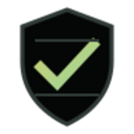
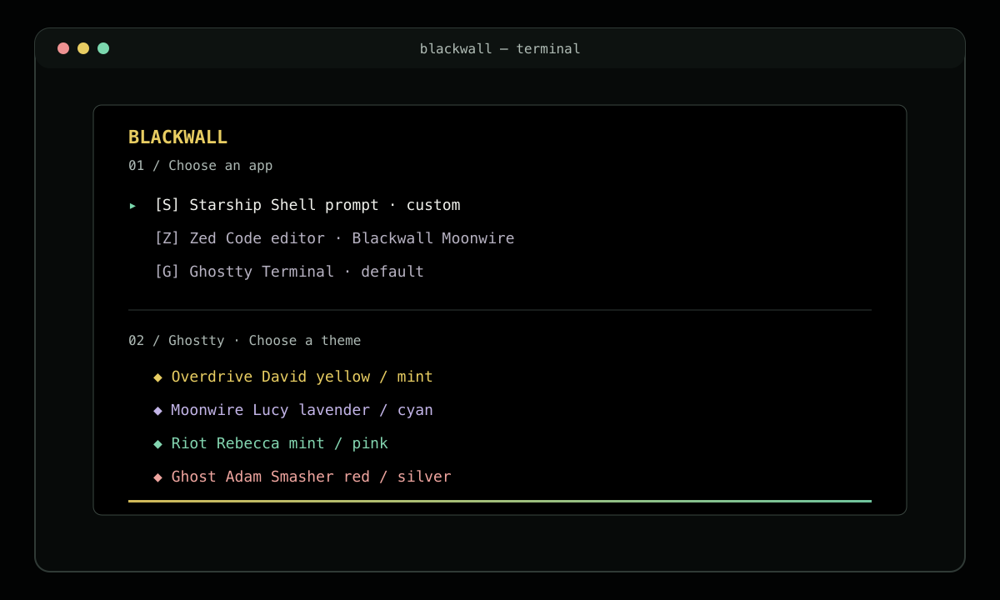
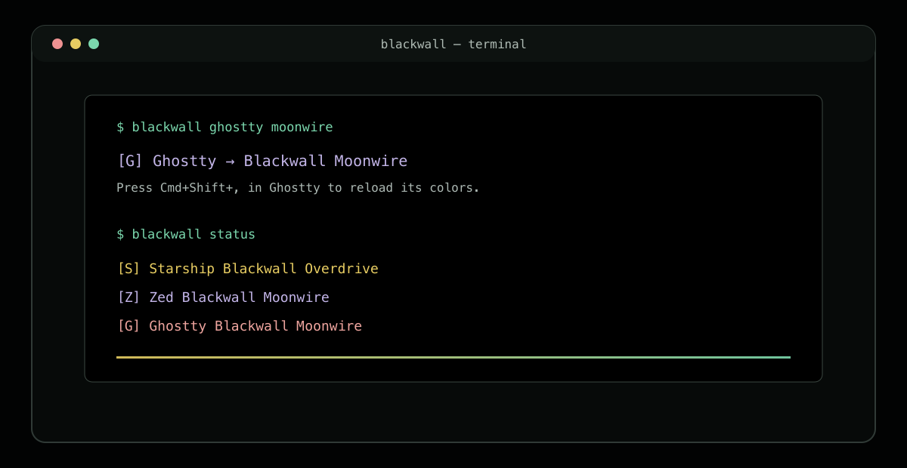

<p align="center">
  
</p>

<h1 align="center">Blackwall</h1>

<p align="center">
  A cyberpunk theme picker for <a href="https://starship.rs/">Starship</a>, <a href="https://zed.dev/">Zed</a>, and <a href="https://ghostty.org/">Ghostty</a>.
  <br />Choose a palette once and keep your shell, editor, and terminal in the same world.
</p>

<p align="center">
  <a href="https://github.com/mesterM12/blackwall/actions/workflows/checks.yml"></a>
  <a href="https://www.python.org/downloads/"></a>
  
  <a href="https://github.com/mesterM12/blackwall"></a>
</p>

<p align="center">
  
</p>

## What it does

Blackwall applies four dark, cyberpunk palettes independently to the tools you use every day:

| Palette | Character cue | Accent rail |
| --- | --- | --- |
| **Overdrive** | David | Yellow + mint |
| **Moonwire** | Lucy | Lavender + cyan |
| **Riot** | Rebecca | Mint + pink |
| **Ghost** | Adam Smasher | Red + silver |

It updates only the selected app, backs up files before changing them, and leaves unrelated settings (including Pi) alone. Zed JSONC comments and trailing commas are preserved. The generated Starship, Zed, and Ghostty presets are checked into the repository so they can be reviewed and reproduced.

## Install

### Requirements

- Python **3.9+** (standard library only)
- [fzf](https://github.com/junegunn/fzf) for the keyboard picker (optional; a numbered menu is used without it)
- A [Nerd Font](https://www.nerdfonts.com/) for the terminal icons
- At least one of Starship, Zed, or Ghostty already installed and configured

Blackwall currently targets the standard macOS config paths. Custom `XDG_CONFIG_HOME` and `STARSHIP_CONFIG` locations are not supported.

### From a checkout

```sh
git clone https://github.com/mesterM12/blackwall.git
cd blackwall
python3 scripts/install.py
blackwall
```

The installer creates `~/.local/bin/blackwall` as a symlink to this checkout. Add the following to your shell profile if that directory is not on `PATH`:

```sh
export PATH="$HOME/.local/bin:$PATH"
```

Keep the checkout in place while you use the command. Re-running the installer is safe and preserves an existing launcher in `~/.config/blackwall/backups/`.

## Use it

```sh
blackwall                    # choose an app, then a palette
blackwall zed                # open Zed's palette picker
blackwall ghostty lucy       # apply Moonwire to Ghostty
blackwall status             # show each app's current selection
```

Theme names are `overdrive`, `moonwire`, `riot`, and `ghost`. Character aliases are also accepted: `david`, `lucy`, `rebecca`, `smasher`, and `adam`.

<p align="center">
  
</p>

After applying a palette:

- Starship uses it at the next prompt.
- Zed watches its settings and refreshes automatically.
- Ghostty on macOS reloads with <kbd>Cmd</kbd> + <kbd>Shift</kbd> + <kbd>,</kbd>.

Each change is written under `~/.config/` and the previous files are copied to `~/.config/blackwall/backups/<timestamp>/`, keeping their home-relative paths. Restore a backup by copying the file back to its original location and reloading the app.

## How the repository is organized

```text
blackwall/
├── bin/blackwall             # CLI, picker, status, backups, and config updates
├── themes/                   # source palettes and generated app presets
│   ├── blackwall-*.json      # palette source files
│   ├── ghostty/              # generated Ghostty themes
│   ├── starship/             # generated Starship prompts
│   └── zed/                  # generated Zed theme family
├── scripts/build-themes.py   # regenerate app presets from source palettes
├── scripts/install.py        # install/update the ~/.local/bin launcher
├── tests/test_cli.py         # isolated-home behavior tests
└── .github/workflows/        # Python 3.9 and 3.14 checks
```

## Develop

The project has no runtime package dependencies. From the repository root:

```sh
python3 scripts/build-themes.py
python3 -m unittest discover -s tests -v
```

`build-themes.py` is deterministic. CI regenerates the committed assets and fails if the working tree changes, which keeps the source palettes and app presets in sync.

## Backups and removal

To update an existing checkout:

```sh
git pull --ff-only
```

The launcher already points at the checkout, so the updated CLI is available immediately. Re-apply a palette to pick up regenerated presets.

To remove the command while keeping app settings and backups:

```sh
rm ~/.local/bin/blackwall
```

## License

No license file is included yet. Add a `LICENSE` file before redistributing Blackwall under an open-source license.

<p align="center">
  <sub>Built for terminal people who like their interfaces quiet, dark, and a little dangerous.</sub>
</p>
